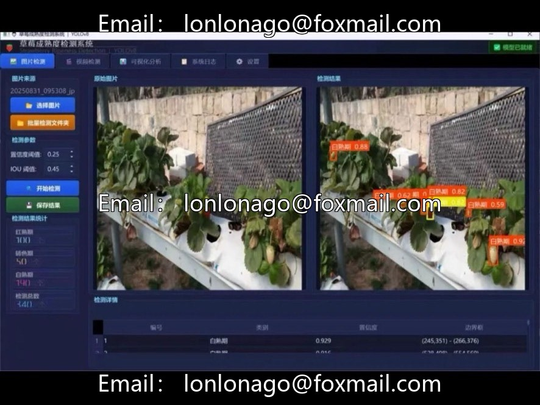
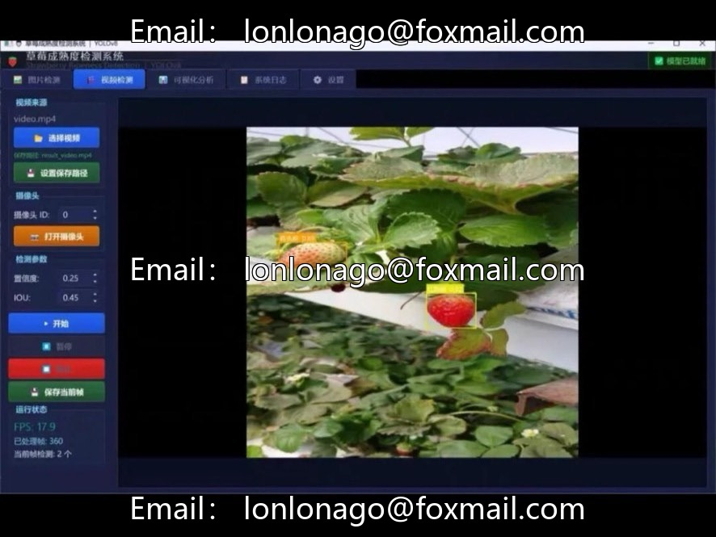
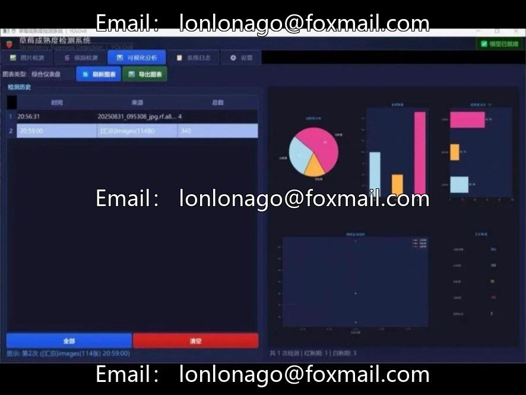
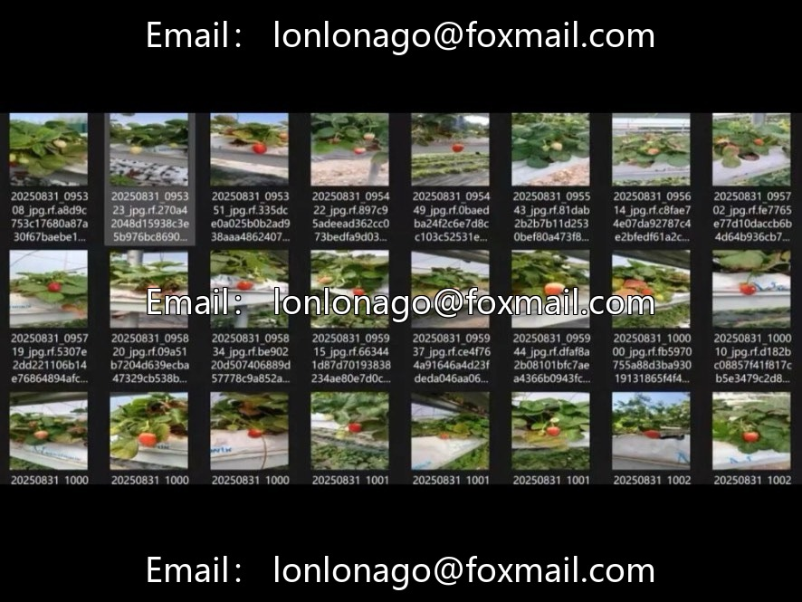
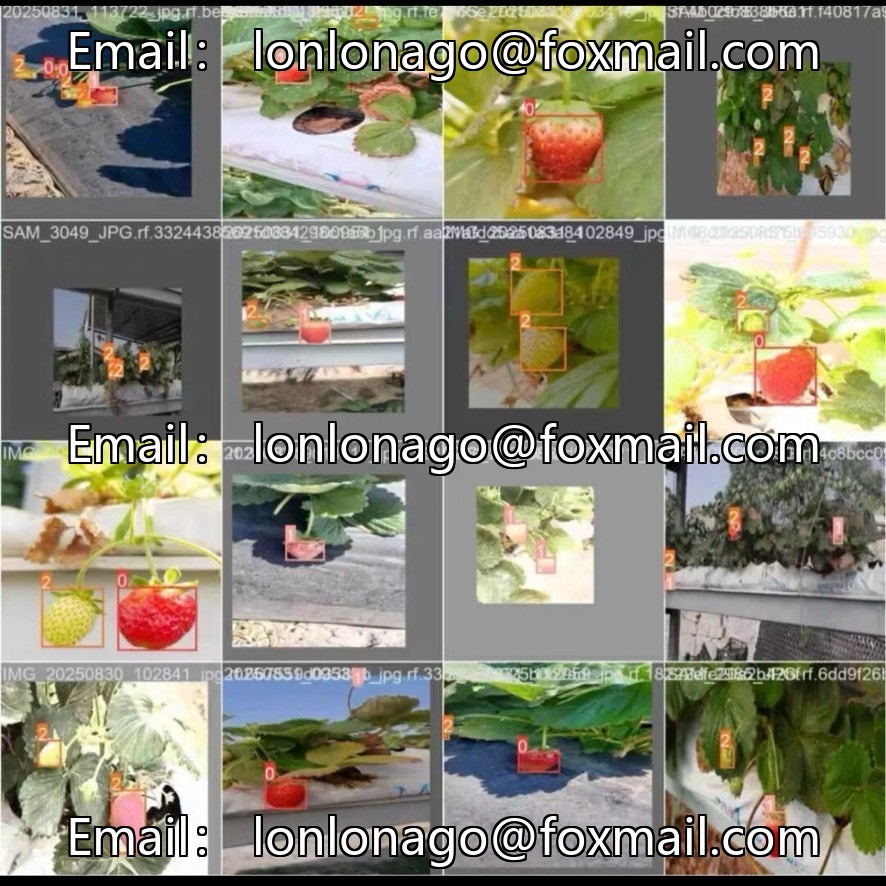

# Strawberry maturity detection software resources

## Body

Strawberry Maturity Detection Software Resources Strawberry Maturity Detection System (YOLOv8 + PyQt5
This system is designed for smart agriculture and precision harvesting scenarios, providing a complete strawberry maturity recognition detection solution. Based on the YOLOv8 model, combined with PyQt5 graphical interface, it covers a dataset of 566 images, including three categories of maturity (white ripening stage, turning color stage, red ripening stage), along with training scripts and deployable desktop applications. It supports the entire process from model training to application deployment.

Dataset specifications
- Total number of images: 566
- Number of categories: 3 categories of maturity
- Annotation format: YOLO format (.txt)
- Data splitting: It is recommended to divide the dataset into training, validation, and test sets at a ratio of 8:1:1

Model Performance
- Training Framework: YOLOv8 Ultralytics
- mAP@0.5: 0.759
- Provide trained .pt weights files, which can be directly used for inference or exported in ONNX/TorchScript format for deployment

System Functions and Architecture
- Technology Stack: Python + PyQt5 + Ultralytics YOLOv8
- Core Functional Modules
  1. User Management: Login and registration pages
  2. Multi-source input: Support for real-time detection of images, videos, and cameras
  3. Detection Modes: Single detection, batch detection, results can be saved
  4. Results Visualization: Image superimposition with detection boxes and labels, pie chart and bar graph displays, comprehensive dashboard
  5. History Recording: Detection operation history, support for viewing and clearing
  6. System Logs: Full record of operations and error information, support for export
  7. Model Management: Support for dynamic loading different .pt weight files without restart

Applicable scenarios
- Intelligent harvesting: Assist in determining the optimal picking time, enhancing fruit quality.
- Orchard monitoring: Regular photography and analysis to grasp the overall ripeness distribution.
- Grading and sorting: Automated grading to reduce labor costs.

This product is a virtual electronic item, which will be dispatched once it is shipped.

## Images

## Payment

Here is a pay link on Stripe ( https://buy.stripe.com/3cs8yP7sY87d0vu9AB ). Please contact me lonlonago@foxmail.com after funding $89, and I will send you a complete data files , thank you!

